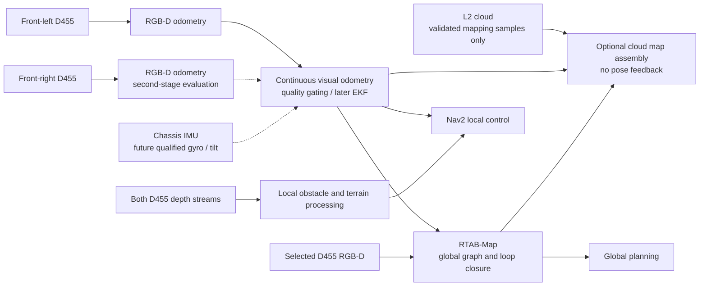

# AGH SLAM review and Kanga implementation plan

Review date: 17 September 2026. Status: proposed architecture and delivery plan;
no estimator or hardware configuration changed by this review.

**Recommendation, revised after Kanga's field-test feedback:** adopt AGH's
separation of local odometry, global correction, and live obstacle perception.
Use D455 visual odometry as the motion reference, with RTAB-Map providing visual
loop closure. Use the L2 initially only for optional map geometry placed using
the visual trajectory. Neither L2 registration nor its IMU may influence the
production trajectory until separately qualified. Start with one visual tracker,
then evaluate independent trackers for both cameras and quality-gated fusion.
Do not port AGH's custom odometry combiner. L2 troubleshooting is not a dependency
for delivering camera-based autonomy.

## Scope and evidence

Reviewed AGH `kalman_slam`, its hardware image pipeline, the ARCh autonomy
bringup, and relevant Nav2 configuration at commit
[`23d43acf5a63a960e19444e1f0c03b52f9257a91`](https://github.com/agh-space-systems-rover/kalman_robot/tree/23d43acf5a63a960e19444e1f0c03b52f9257a91),
dated 1 September 2026. This is a source/configuration review, not a reproduction
of competition performance. Their competition success does not establish which
commit, configuration, or operator interventions produced it.

Kanga's checked-out baseline was `bf45db2b2b2120182e0de00dcb8a797868c2e39c`.
Its SLAM and Nav2 packages are architecture placeholders; camera integration
is provisional. The plan assumes ROS 2 Humble, an **Orin Nano 8 GB**, two
**D455s facing front-left and front-right**, a **Unitree L2**, and a separate
chassis IMU that is not yet reliable. An Orin NX upgrade is not a dependency.
No reliable physical wheel odometry or GNSS was assumed.

The user subsequently reported L2 timing problems, approximately +/-100 mm
position fluctuations in all axes with **RTAB-Map ICP odometry**, despite
plausible overall motion and a reasonable-looking map, and severe runaway with
[`dfloreaa/point_lio_ros2`][point-lio-ros2]. The user explicitly clarified that
the first test used ICP, not IMU-only integration. These observations supersede
the original LiDAR-first recommendation. The cause of ICP jitter is not yet
established; it must not be automatically attributed to the IMU or treated as
the same failure as Point-LIO runaway.

Findings below distinguish directly visible behavior from risks that require
bags or hardware to establish. No AGH ROS nodes were built or run in this review.

## What AGH actually runs

Their [launch file][agh-launch] has two mutually exclusive estimator paths:

| Mode | Local motion estimate | Global correction |
| --- | --- | --- |
| `slam_rgbd_ids` empty | One RTAB-Map RGB-D odometry node per camera; local `robot_localization` EKF combines twists and IMU angular velocity | Global EKF combines local velocity, IMU orientation, GPS-derived position, and optional fiducial XY observations |
| `slam_rgbd_ids` nonempty | Per-camera RGB-D odometry poses feed custom `dead_reckoning`; IMU orientation provides gradual correction | RTAB-Map receives the combined odometry and one or more RGB-D cameras; publishes `map -> odom` |

The [ARCh PC autonomy profile][agh-arch] chooses the second path with four D455s
facing front, back, left, and right, and disables magnetometer yaw correction.
It does **not** run a global EKF alongside RTAB-Map. Launch comments describing
the global EKF as publishing `map -> base_link` describe its state estimate;
with `world_frame: map`, the intended TF output is `map -> odom`.

Their SLAM YAML explicitly disables scan and scan-cloud subscriptions. The
multi-camera setting `Vis/EstimationType: 0` selects **3D-to-3D visual feature
registration**; despite the comment mentioning ICP, this is not a LiDAR ICP
pipeline. Mapping runs at 3 Hz for one camera and 2 Hz for multiple cameras.
See the [single-camera][agh-single] and [multi-camera][agh-multi] configurations.

## What is worth adopting

| Strength | Why it helps | Kanga adaptation |
| --- | --- | --- |
| Separate continuous odometry and global correction | Loop closure need not directly jump the controller's local reference | One owner of `odom -> base_link`; RTAB-Map owns `map -> odom` |
| Several camera views | Independent trackers can survive loss of texture or visibility in one direction | Preserve camera independence, but recognise that two forward cameras have more shared failure modes than four surrounding cameras |
| Explicit visual tracking-loss behavior | `publish_null_when_lost` and reset policy allow recovery after losing features | Consume health/reset signals explicitly and preserve a continuous rover odometry frame |
| Established ROS libraries | RTAB-Map, robot_localization, and Nav2 reduce maintenance of general algorithms | Keep upstream algorithms external and Kanga packages focused on integration |
| Composition and rate control | Reduces transport overhead and bounds image work | Compose each camera's preprocessing where supported; benchmark the actual path |
| Correct depth/image preprocessing details | Aligned depth, nearest-neighbor depth resizing, and scaled camera intrinsics preserve geometric meaning | Validate the complete calibrated image contract before tuning SLAM |
| Live obstacle perception separate from mapping | Navigation can react faster than global graph updates | Feed both camera depth streams into a rolling local obstacle map; qualify L2 obstacle use separately |
| Gravity-aware ground classification | Surface slope is more meaningful in a gravity-aligned reference | Use a stable local reference and measured terrain limits |

Evidence: [RGB-D odometry policy][agh-vo], [image filter][agh-filter],
[RealSense configuration][agh-realsense], [obstacle processing][agh-obstacles],
and [costmap configuration][agh-costmap]. These are sensible integration choices,
not proof that every tuning value transfers to a different rover.

## Weaknesses and concrete improvements

### 1. The custom combiner lacks confidence-aware fusion — high priority

In [dead_reckoning_node.cpp][agh-dead], `mean_affine()` equally averages accepted
motion increments. Input covariance and tracking quality are unused; output
pose covariance is a fixed diagonal, default 0.1. No output twist is populated.

One plausible but wrong camera can therefore pull the result away from a good
camera. Losing a source does not meaningfully change reported uncertainty.
Downstream velocity consumers must not interpret its default zero twist as a
measurement. Replace this with a proven estimator or explicit quality-gated
source selection, with uncertainty and measured velocity contracts.

### 2. Dropout recovery has identifiable edge cases — high priority

The same [source][agh-dead] contains these static findings:

| Trigger | Result visible in code | Needed correction/test |
| --- | --- | --- |
| Equal consecutive timestamps | Only `< last_time` is rejected; velocity divides by zero duration | Reject nonpositive intervals and nonfinite data |
| Long gap without a null/reset indication | Duration is clipped before dividing the full pose change | Reject/reinitialise the gap or use its true duration; test delayed messages |
| Valid pose at origin with identity rotation | Null detection ignores quaternion `w`, so identity is treated as lost | Use explicit validity/reset information |
| Designated camera stops in single-SLAM-camera mode | `sync_with_odom` only publishes when that camera's delta is consumed | Decouple estimator output from any one camera's arrivals |

For example, moving 1 m over a 2 s gap with a 0.5 s cap produces a computed
2 m/s rather than 0.5 m/s. This is an illustration of the source arithmetic,
not a hardware measurement. The final integrated error depends on buffering.
AGH's configured null-on-loss behavior mitigates some reset cases, but not
all transport failures.

### 3. IMU correction is a heuristic — medium/high priority

The custom node averages orientation disagreement over a window and applies a
proportional correction. It does not estimate inertial biases or perform
LiDAR motion compensation. This is a practical drift correction, not tightly
coupled inertial odometry. Its IMU subscription also requests default reliable
QoS. Directly transplanting it onto Kanga's best-effort `/core/imu/data`
publisher would prevent matching. See [ROS 2 QoS compatibility][ros-qos].

Kanga should validate sensor conventions and transport first, then use a
maintained inertial estimator. Do not feed the same IMU into LIO and then
blindly fuse it again with that LIO result as an independent measurement.

### 4. Restart behavior discards the default SLAM database — high priority

The [SLAM launch][agh-launch] unconditionally supplies RTAB-Map `-d`.
That is useful for a deliberately fresh experiment but unsuitable as the
default for map reuse or crash recovery. Provide explicit `new_map`, `resume`,
and `localization` modes, persistent session paths, and backup/restart tests.

### 5. Multi-camera mapping couples availability and adds work — medium priority

The [launch][agh-launch] combines every selected camera into an RGB-D array;
an absent required stream can stall that input. It also routes the array
synchronizer through `/rgbd_image/compressed` despite composition. Compression
can save network bandwidth but adds encode/decode work locally.

The [multi-camera YAML][agh-multi] documents their move away from PnP because
of OpenGV availability and their concern about reduced robustness. This is
dependency-specific, not an inherent proof that multiple cameras are worse.
Verify the installed RTAB-Map build and registration options before adopting
that configuration. Start with one mapping camera and add the second only
after measured improvement justifies cost and synchronization complexity.

### 6. Initial certainty is overstated in global aids — medium priority

[GPS preprocessing][agh-gps] replaces NaN covariance with zero and forces
initial diagonal covariance to zero for five seconds. That can force fast
convergence toward a poor fix; zero uncertainty is not a valid repair for an
unknown measurement. Validate fix status and finite coordinates, preserve or
conservatively bound uncertainty, and initialise the origin explicitly.

[Fiducial odometry][agh-fiducial] uses a fixed XY variance after an initial
zero-covariance message. It derives translation correction using the current
map heading, so heading error can become a position correction. Prefer
geometrically validated observations with uncertainty dependent on range and
viewing angle, and account for reuse of the current state estimate. Its
deactivation callback also references `self.pub.pub_tf`, which is not created.

These aids are not wired into the reviewed RTAB-Map mode simply by enabling
the fiducial node: its consuming global EKF is absent in that mode. Kanga does
not need GPS/fiducial fusion in its first milestone.

### 7. Outdoor traversability needs more than their obstacle tuning

Their [obstacle configuration][agh-obstacles] accepts ground normals up to
0.7 rad (about 40 degrees), removes small isolated groups, and limits obstacle
height relative to the robot. Such thresholds depend on rover clearance,
stability, point density, and terrain. They can suppress small hazards or
accept terrain a different rover cannot traverse.

Both costmaps inherit `map` unless overridden, and the reviewed local section
does not override it. Prefer an `odom` local costmap to isolate control from
global corrections. Their [costmap][agh-costmap] also makes deliberate
unknown-space and voxel-decay tradeoffs. Treating an unobserved cell or a
disappearing depth return as clear is especially problematic around drop-offs.
Add explicit slope, step, roughness, clearance, and missing-ground handling;
test clearing as carefully as marking. Voxel decay is useful, but is not
positive evidence of free ground.

### 8. Validation and observability should be stronger

The package [CMakeLists][agh-cmake] registers lint checks, but no estimator
behavior tests. This does not establish what private or field testing exists.
The launch suppresses much odometry logging, and EKF diagnostics are disabled.
Kanga should expose tracking quality, source age, covariance, reset counts,
loop-closure corrections, and processing delay, and maintain replayable failure
cases. A visually convincing point cloud is not an accuracy measurement.

## Kanga sensor integration findings

### L2: mapping-only until reliability is demonstrated

The user's observed instability is an architectural constraint. A convincing
map does not qualify its underlying odometry for control. Keep both L2 odometry
and the L2 IMU out of production pose estimation, including RTAB-Map scan-based
loop-closure refinement. First establish an entirely camera-based trajectory.

The [ROS 2 Point-LIO port][point-lio-ros2] explicitly supports Humble, but
[issue #5][point-lio-issue5] remains open. Its comments report stationary
runaway, irregular IMU intervals, timing-offset experiments, and mixed outcomes
with alternative implementations. The maintainer discussed startup geometry
and a possible recurring algorithm bug. This is evidence of unresolved
integration risk, not a confirmed diagnosis of Kanga's unit. No reliable fix
was established by the comments reviewed on 17 September 2026.

Do not convert a reported ~100 ms cloud delivery age directly into an IMU offset:
a cloud stamped at scan start can arrive after collecting ~100 ms of points.
Check `cloud_stamp + point.time` against IMU acquisition times and arrival
times. Acquisition-time jitter, batching, transport delay, clock drift, and
incorrect parser units are different problems. Replacing every stamp with
`now()`, applying an arbitrary constant shift, or smoothing the output can hide
symptoms without correcting the measurement model.

Analyse the +/-100 mm fluctuations in the ICP odometry topic,
`odom -> base_link`, and `map -> odom` separately. Possible contributors include
registration instability, timing/deskew errors, TF conflicts, or global graph
corrections. These remain hypotheses without the actual configuration/bag.
Map accumulation, voxelisation, and graph optimisation can conceal short-term
pose noise. Bounded jitter and unbounded runaway are separate failure modes.

The official [SDK2][l2-sdk] provides point clouds and an internal IMU. Its
point representation retains `time` and `ring`, making motion compensation
possible if the selected estimator parses their units and reference correctly.
Verify cloud-start versus cloud-end time, clock domain, ordering, packet loss,
and measured LiDAR/IMU offset. Do not discard per-point time before deskewing
or compensate a scan twice. Treat “4D” as a product label, not evidence of a
Doppler velocity measurement.

Driver inspected at commit `0e3c51f512e6b8ff60b8c32f160b412cb48445c2`:

- The [ROS 2 wrapper][l2-driver] unconditionally publishes
  `unilidar_imu_initial -> unilidar_imu -> unilidar_lidar`. Disable or isolate
  these demonstration transforms before attaching both sensors to Kanga's
  calibrated TF tree.
- The IMU message and demonstration TF use **different quaternion component
  orderings** for the same array. This inconsistency needs a stationary and
  known-axis rotation check against the protocol before trusting orientation.
  LIO consuming raw gyro/acceleration is a separate path, but still needs
  validated units and extrinsics.
- [Launch defaults][l2-launch] select system timestamps and aggregate scans.
  Neither proves accurate cross-sensor timing. Choose aggregation from measured
  latency and registration quality; do not copy defaults blindly.

The official SDK documents ROS 2 Foxy testing; Kanga must qualify its pinned
build on Humble and the Jetson environment. Unitree's [Point-LIO adaptation][point-lio]
supports L2 but documents a **ROS 1/catkin** workflow. Algorithm suitability
does not make it a drop-in Humble package. The linked third-party ROS 2 port
exists and is the implementation the user already tested unsuccessfully; its
availability does not establish reliability.

### Chassis IMU: gravity and timing must be explicit

Current [firmware](../../src/kanga_core/kanga_core_microcontroller/firmware/kanga_core_esp32/tasks_imu.cpp)
calls `dmpGetLinearAccel` and transmits gravity-removed acceleration. The
[CAN bridge](../../src/kanga_core/kanga_core_microcontroller/src/core_can_bridge.cpp)
publishes it in `sensor_msgs/Imu` and stamps the assembled sample at host
publication time. This is not automatically the raw specific-force input
expected by a LIO estimator.

Document the existing convention; do not remove gravity a second time. If
using this sensor for LIO later, expose correctly timestamped raw acceleration
and gyro with consistent sample association, measured mounting transform and
noise. Confirm actual firmware behavior, including that the emulated IMU path
is disabled. Start with angular velocity/validated tilt if adding it to a
general local estimator; do not integrate acceleration into position merely
because the message is available.

### Two forward D455s: visual motion reference and obstacle coverage

Each D455 already contains its own stereo depth system. Do not treat the two
complete cameras as a new stereo pair. Calibrate each camera to the rover,
measure overlap and close blind spots, and ensure the body/arm does not dominate
the images or point clouds. Both views can fail together on glare, poor texture,
dust, or USB problems. They provide no rear visual coverage.

Keep both depth streams for terrain/obstacles. Establish single-camera visual
odometry separately for each, then evaluate simultaneous independent trackers.
Use the more stable textured view for initial loop closure. Use both in the
global mapping frontend only after a recorded-data comparison; two independent
odometry sources do not require a synchronised two-camera graph input.
Verify aligned depth and CameraInfo together,
serial-number assignment, shared USB load, exposure behavior, and cross-camera
timing. Hardware synchronization is an option to qualify, not a guarantee that
all RGB, depth, and host timestamps automatically coincide. The manufacturer's
[multi-camera guidance][realsense-multi] covers these integration concerns.

## Proposed architecture

Arrows show intended data flow and qualification stages. RTAB-Map's production
trajectory is based on camera observations and external visual odometry. The
optional cloud-map consumer associates L2 observations with timestamped visual
poses. It cannot publish localisation TF, add scan-registration constraints,
or block camera odometry/graph processing when LiDAR data is missing.

| Contract | Authority / consumer |
| --- | --- |
| `map -> odom` | RTAB-Map only |
| `odom -> base_link` | Initial visual odometry authority; later the qualified local EKF only |
| `base_link -> sensors` | Calibrated robot description; one publisher per edge, with camera optical frames handled consistently |
| `/slam/odometry` | Proposed stable local odometry interface, pose and meaningful twist/covariance |
| `/slam/status` | Proposed health interface, including age, validity, degraded source, reset state |
| Local costmap | `odom`; live sensor observations independent of mapping updates |
| Global costmap | `map`; persistent map and/or mission map plus current observations |
| Optional L2 map | Geometry product only, initially excluded from navigation until validated |

The autonomy bringup must pass `use_body_pose_tf:=false` to core bringup.
The existing `body_origin -> base_link` display transform would otherwise give
`base_link` a competing parent. Do not use `/core/body/pose` translation as
odometry or Gazebo `/core/odom` ground truth as an estimator input.

Keep the estimate in 3D for sloping terrain. A 2D planning projection should be
an explicit interface, not `two_d_mode` flattening of the underlying estimator.
If a projected footprint frame is needed, define its single owner separately.

### Algorithm decision

1. **First baseline:** RTAB-Map `rgbd_odometry` with one D455, without IMU or
   LiDAR dependencies. Evaluate left and right individually using identical
   routes and choose the stronger initial view. Tracking loss stops autonomy;
   a frontend reset must not silently become a rover-frame jump.
2. **Two-camera odometry:** run independent `rgbd_odometry` nodes if the Nano
   sustains the load. Disable their individual TF outputs and evaluate a local
   `robot_localization` EKF consuming quality-gated body-frame velocity estimates
   with conservative, measured covariance. Do not fuse independently reset
   absolute poses. Verify RTAB-Map twist timing and covariance against pose
   increments rather than assuming they are suitable. Drop invalid, stale,
   reset-spanning, or physically implausible samples before fusion. Correlated
   views require conservative weighting; disagreement alone does not reveal
   which camera is correct. If neither is trustworthy, stop.
3. **Global SLAM:** RTAB-Map with external continuous visual odometry and one
   mapping camera initially. Keep all LiDAR scan registration/refinement disabled.
   Evaluate a joint multi-camera visual frontend only if it beats independent
   trackers on quality, failure recovery, and Nano resource use.
4. **Later chassis IMU:** add qualified angular velocity and, where validated,
   gravity-referenced tilt. Do not start with acceleration-derived translation
   or assume absolute yaw from an unreferenced IMU. Fusion must account for any
   IMU measurements already used in visual estimation.
5. **Optional L2 research:** ICP, [KISS-ICP][kiss], or Point-LIO may run in an
   isolated diagnostic profile with private topics and no production TF output.
   Promotion requires fresh evidence; none is the presumed production upgrade.

The EKF is a candidate for combining reliable observations and maintaining a
continuous state, not a repair for broken timing or arbitrary resets. Avoid
double-counting pose and twist derived from the same camera. Never feed global
loop closure corrections back into the local estimate as ordinary odometry.
[robot_localization guidance][rl-config] explains selective fusion and duplicate
information. Two forward views can fail together; this design needs an explicit
lost-tracking state rather than reliance on an unqualified LiDAR fallback.

### L2 map geometry without LiDAR pose estimation

Start with a separate optional cloud-map output, leaving camera localisation
fully functional with the L2 unplugged. Use timestamped camera-derived poses to
place scans. Retain clouds against keyframes/submaps and reassemble their poses
after visual graph corrections; a permanently accumulated cloud cannot be
fixed by merely changing the current `map -> odom` transform.

This still requires usable cloud timestamps and spatial calibration. When
within-scan timing cannot be trusted, prefer stationary/settled captures and
reject scans taken during turns or rapid motion. Even with good timing,
deskewing from the camera trajectory is limited by its update rate and accuracy.
Do not mark motion-distorted map geometry as trusted navigation obstacles or
free space. Qualify L2 obstacle use separately; cameras remain the initial live
obstacle source. Future integration into RTAB-Map's stored scan data is acceptable
only after proving it adds geometry without scan-based pose feedback or a
LiDAR-dependent synchronisation bottleneck.

### Orin Nano 8 GB starting budget

These are initial profiling settings and acceptance targets, not measured
performance claims:

| Work | Starting point |
| --- | --- |
| Cameras | Both at a supported approximately 640x480 profile, 15 Hz aligned depth/RGB as needed; increase only for measured perception benefit |
| Odometry | One RGB-D frontend initially; profile two independent frontends next, targeting fresh estimates at least 10 Hz; faster EKF publication is not new visual evidence |
| Global graph | One camera, 1–2 Hz initial keyframe processing; bound memory and persist to SSD |
| Local costmap | 5–10 Hz initial target; approximately 0.1 m cells, adjusted for minimum obstacle size |
| Point clouds | Self-filter and bound optional map assembly; retain raw timestamps for diagnosis; no production LIO |
| Operation | Headless onboard; visualisation on basestation; bounded queues and measured recording load |

The GPU does not automatically accelerate ordinary ICP, graph optimisation,
or every RTAB-Map feature path. Profile CPU time, memory bandwidth, memory
pressure, and thermal throttling alongside GPU use. Aim to retain roughly
1.5–2 GB of measured system headroom under the **complete** autonomy workload;
reduce work if that proves unattainable. Avoid sustained swapping. An NX upgrade
may allow richer perception but should not change estimator interfaces.

## Delivery plan and acceptance gates

| Stage | Deliverable | Gate before moving on |
| --- | --- | --- |
| 0. Camera contract | Pinned camera drivers, serials, aligned depth/intrinsics, URDF extrinsics, TF ownership, recording profile | 20-minute capture/replay with timestamps/QoS checked, no conflicting TF parents, measured losses and queue ages; no dependency on L2 repair |
| 1. Visual baseline | Left and right RGB-D odometry evaluated individually | Repeatable straight/turn/loop results; no silent reset or invalid pose; resource use recorded |
| 2. First mapping system | Visual odometry plus RTAB-Map, one mapping camera, persistent sessions | Loop closure and restart demonstrated; continuous `odom`; unplugging L2 has no effect |
| 3. Camera redundancy and navigation | Independent camera trackers with gated local fusion if beneficial; both depth views for obstacles; Nav2 health gating | Camera occlusion/restart tests; valid pose/twist/covariance; terrain and clearing tests; Nano budget sustained |
| 4. Optional L2 map | Timestamp-qualified clouds placed on the visual trajectory, initially stationary captures | Known geometry aligns; scan rejection works; graph corrections reassemble geometry; no effect on estimated trajectory or localisation availability |
| 5. Selective improvements | Qualified chassis IMU, second mapping camera, wheel velocity, optional landmarks | Each addition improves held-out field results |
| Separate research | L2 timing diagnosis and experimental odometry | Repeated cold-start, stationary, motion, loss/restart, and loaded-Nano tests pass before any proposal to give it pose authority |

**First implementation change:** D455 bringup, calibrated frames, recording,
and a standalone single-camera RGB-D odometry launch. Preserve an L2 diagnostic
recording profile, but do not make camera delivery wait for that investigation.

Package responsibilities:

- `kanga_cameras`: D455 profiles and stable camera topic contracts.
- `kanga_description` / core description: sensor mounts and physical transforms.
- `kanga_slam`: estimator profiles, external algorithm integration, RTAB-Map
  sessions, quality/status, and TF ownership contracts.
- `kanga_nav2`: terrain/obstacle configuration, local/global maps, navigation
  integration, and response to localisation health.
- `kanga_bringup`: whole-rover composition and disabling display-only body TF.
- L2 driver remains upstream; initially launch it through the autonomy
  composition. Add a small dedicated sensor integration package only when
  reusable calibration/driver adaptation justifies it.

The health response belongs in autonomy command gating and the existing WHS
contract, not a second competing motor-stop authority. When primary odometry
fails, the first release should stop autonomy. Switching between camera sources needs
quality checks, hysteresis, transform alignment at handover, and reset handling;
changing the TF publisher alone is not seamless recovery. If the dedicated
mapping-camera stream fails while another camera still provides qualified local
odometry, mark global correction as degraded and bound travel on local drift.
An L2 outage stops optional map accumulation and does not affect localisation.

Before reconsidering L2 odometry, require at least 20 repeatable cold starts
without runaway, stationary pose/velocity stability materially better than the
reported +/-100 mm fluctuations, repeated surveyed moving routes, timing
diagnostics under full Nano load, and explicit recovery after sensor restart.
Set numeric jitter limits from clearance/control requirements before testing;
a successful demo or a smoothed trajectory is insufficient. Preserve both
failure and success bags plus exact firmware/SDK/estimator revisions.

## Evaluation protocol

Record camera images/depth/CameraInfo, original L2 cloud fields, raw available
IMUs, `/tf`, `/tf_static`, wheel feedback, commands, diagnostics, estimated poses,
and estimator quality. Save calibration, parameter versions, firmware versions,
and power/thermal settings with every bag. Test the recorder's own losses.

Use at least three repeated runs per representative route: stationary;
surveyed straight travel; in-place turns both ways; a 50–100 m loop; rough and
sloping terrain; low-texture open ground; bright light and shadow transitions;
approaching close obstacles. Use surveyed checkpoints or an independent
reference. Report ATE/RPE only when time-aligned reference trajectories exist;
otherwise report checkpoint and loop-return errors honestly.

Fault cases: obscure each camera separately and both together; unplug/restart
one camera; stop LiDAR/IMU data; duplicate/reorder/drop timestamps; restart the
frontend and backend independently; replay with simulated time; revisit a
saved map; introduce a visually similar but distinct location to test false
loop closure. Check rear and lateral clearance during turns and reversing:
front-facing depth coverage plus a 360-degree LiDAR is not proof of observed
ground beneath the whole swept footprint.

Suggested initial targets, to refine from course geometry and stopping tests:

- Local odometry has no unannounced resets, NaNs, or conflicting TF publishers.
- At low test speed, 95th-percentile pose age below 150 ms and obstacle age below
  200 ms; record worst cases, not just averages. A faster LIO output stamped
  from old data does not meet freshness requirements.
- Before loop closure, aim for at most 1% translational loop-return error over
  50–100 m; after valid correction, aim for at most 0.3 m and 3 degrees at
  independently measured checkpoints. These are goals, not guaranteed accuracy.
- Detect stale primary odometry within a proposed 250 ms, then verify actual
  command inhibition and stopping distance. Tighten that limit when necessary.
- Establish a 30-minute complete-system thermal/memory run, followed by a full
  expected mission-duration run with recording and other perception enabled.
- Failures must become visible states; false loop closures and unobserved
  drop-offs must not silently become plausible poses or free space.

Set permitted speed using measured latency, stopping capability, and margin:
`required clear distance >= speed * total delay + braking distance + margin`.
Map appearance alone, or a single closed loop, is not the release criterion.

[agh-launch]: https://github.com/agh-space-systems-rover/kalman_robot/blob/23d43acf5a63a960e19444e1f0c03b52f9257a91/kalman_slam/launch/slam.launch.py
[agh-arch]: https://github.com/agh-space-systems-rover/kalman_robot/blob/23d43acf5a63a960e19444e1f0c03b52f9257a91/kalman_bringup/launch/arch_pc_nav.launch.py
[agh-dead]: https://github.com/agh-space-systems-rover/kalman_robot/blob/23d43acf5a63a960e19444e1f0c03b52f9257a91/kalman_slam/src/dead_reckoning_node.cpp
[agh-single]: https://github.com/agh-space-systems-rover/kalman_robot/blob/23d43acf5a63a960e19444e1f0c03b52f9257a91/kalman_slam/config/rtabmap_slam.yaml
[agh-multi]: https://github.com/agh-space-systems-rover/kalman_robot/blob/23d43acf5a63a960e19444e1f0c03b52f9257a91/kalman_slam/config/rtabmap_slam_multicam.yaml
[agh-vo]: https://github.com/agh-space-systems-rover/kalman_robot/blob/23d43acf5a63a960e19444e1f0c03b52f9257a91/kalman_slam/config/rgbd_odometry.yaml
[agh-filter]: https://github.com/agh-space-systems-rover/kalman_robot/blob/23d43acf5a63a960e19444e1f0c03b52f9257a91/kalman_hardware/src/rgbd_filter_node.cpp
[agh-realsense]: https://github.com/agh-space-systems-rover/kalman_robot/blob/23d43acf5a63a960e19444e1f0c03b52f9257a91/kalman_hardware/config/realsense2_camera.yaml
[agh-obstacles]: https://github.com/agh-space-systems-rover/kalman_robot/blob/23d43acf5a63a960e19444e1f0c03b52f9257a91/kalman_nav2/config/obstacle_detection.yaml
[agh-costmap]: https://github.com/agh-space-systems-rover/kalman_robot/blob/23d43acf5a63a960e19444e1f0c03b52f9257a91/kalman_nav2/config/nav2.costmap.yaml.j2
[agh-gps]: https://github.com/agh-space-systems-rover/kalman_robot/blob/23d43acf5a63a960e19444e1f0c03b52f9257a91/kalman_slam/kalman_slam/gps_preprocessor_node.py
[agh-fiducial]: https://github.com/agh-space-systems-rover/kalman_robot/blob/23d43acf5a63a960e19444e1f0c03b52f9257a91/kalman_slam/kalman_slam/fiducial_odometry_node.py
[agh-cmake]: https://github.com/agh-space-systems-rover/kalman_robot/blob/23d43acf5a63a960e19444e1f0c03b52f9257a91/kalman_slam/CMakeLists.txt
[l2-sdk]: https://github.com/unitreerobotics/unilidar_sdk2
[l2-driver]: https://github.com/unitreerobotics/unilidar_sdk2/blob/0e3c51f512e6b8ff60b8c32f160b412cb48445c2/unitree_lidar_ros2/src/unitree_lidar_ros2/include/unitree_lidar_ros2.h
[l2-launch]: https://github.com/unitreerobotics/unilidar_sdk2/blob/0e3c51f512e6b8ff60b8c32f160b412cb48445c2/unitree_lidar_ros2/src/unitree_lidar_ros2/launch/launch.py
[point-lio]: https://github.com/unitreerobotics/point_lio_unilidar
[point-lio-ros2]: https://github.com/dfloreaa/point_lio_ros2
[point-lio-issue5]: https://github.com/dfloreaa/point_lio_ros2/issues/5
[kiss]: https://github.com/PRBonn/kiss-icp/blob/main/ros/README.md
[rtab-lidar]: https://github.com/introlab/rtabmap_ros/blob/ros2/rtabmap_examples/launch/lidar3d.launch.py
[rl-config]: https://raw.githubusercontent.com/cra-ros-pkg/robot_localization/humble-devel/doc/configuring_robot_localization.rst
[ros-qos]: https://raw.githubusercontent.com/ros2/ros2_documentation/humble/source/Concepts/Intermediate/About-Quality-of-Service-Settings.rst
[realsense-multi]: https://dev.realsenseai.com/docs/multiple-depth-cameras-configuration/
